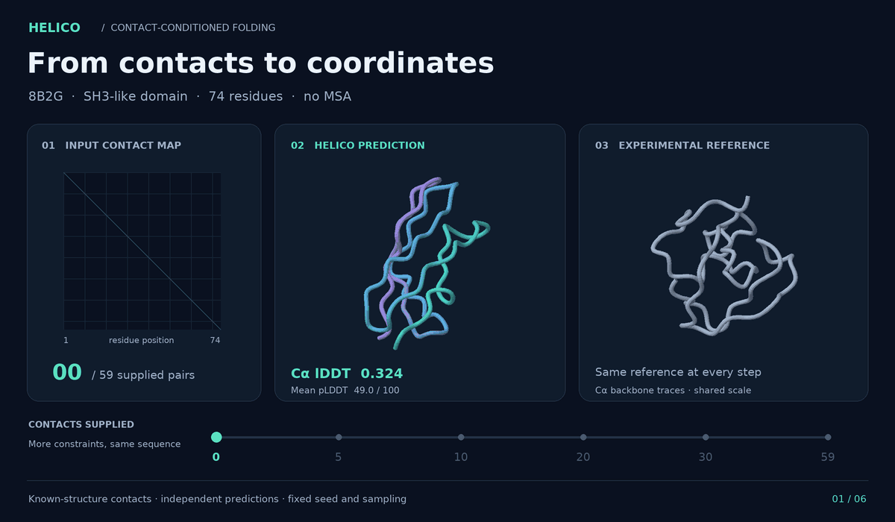
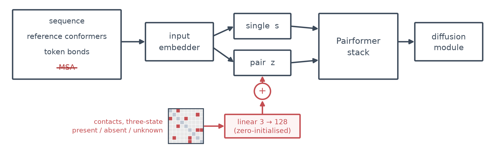

# Helico

**Protein contact maps → 3D structures.** Helico takes an amino acid sequence
and a residue–residue contact map and predicts all-atom coordinates, without a
multiple sequence alignment (MSA). It also gives you a way to **score candidate
contact maps** by evaluating the structures they produce.



*More contacts, same sequence.* Independent Helico predictions for the SH3-like
domain [8B2G, chain A](https://www.rcsb.org/structure/8B2G), with increasing
subsets of contacts from its known structure. Each step keeps the previous
contacts and adds more; all other settings stay fixed. This is an illustrative
example using **ground-truth contacts**, not an end-to-end prediction benchmark.
[Static view, predictions, and reproduction details](docs/images/contact_sweep/README.md).

[](https://colab.research.google.com/github/Open-Athena/helico/blob/main/notebooks/helico_contact_conditioned_folding.ipynb)
[](https://huggingface.co/timodonnell/helico)
[](https://github.com/Open-Athena/helico/actions/workflows/test.yml)

## What you can do

- **Fold from contacts.** Supply contacts from a predictor such as
  [MarinFold](https://github.com/Open-Athena/MarinFold), or your own contact
  hypotheses. Get atom coordinates, a PDB file, and per-atom confidence.
- **Compare contact maps.** Fold the same sequence with different maps and
  compare the resulting structure confidence. When a reference structure is
  available, measure accuracy with lDDT, TM-score, or RMSD.
- **Study how contacts affect folding.** Vary the number or quality of supplied
  contacts while keeping the sequence and model fixed. Partial maps are
  supported; unlisted pairs remain unknown.

Helico predicts **coordinates from contacts**. The contact predictions themselves
come from an upstream model or another source. The released checkpoint is
`contacts-msafree-01-step6000.pt` at
[timodonnell/helico](https://huggingface.co/timodonnell/helico).

## Try it

The [Colab notebook](https://colab.research.google.com/github/Open-Athena/helico/blob/main/notebooks/helico_contact_conditioned_folding.ipynb)
walks through folding and visualizing a protein under several contact conditions.
For local inference, use Python 3.10+ and an NVIDIA CUDA GPU:

```bash
git clone https://github.com/Open-Athena/helico.git
cd helico
uv venv --python 3.10
uv pip install -e .
source .venv/bin/activate
```

Prepare `sequence.txt` with a single amino acid sequence (no FASTA header) and
`contacts.txt` with one pair of **zero-based residue positions** per line:

```text
3 41
7 65
```

Use a sequence long enough for every supplied position. These two pairs only
illustrate the file format; replace them with contacts for your protein.

```python
from pathlib import Path
from helico.inference import contacts_from_pairs, fold, load_model

sequence = "".join(Path("sequence.txt").read_text().split())
pairs = [
    tuple(map(int, line.split()))
    for line in Path("contacts.txt").read_text().splitlines()
    if line.strip()
]

model = load_model()  # downloads the released Helico checkpoint on first use
contacts = contacts_from_pairs(pairs, seq_len=len(sequence), strict=True)
result = fold({"A": sequence}, contacts=contacts, model=model, n_samples=5, seed=0)

result.write_pdb("prediction.pdb")
print(result.coords.shape)  # (number of atoms, 3), coordinates in angstroms
print(result.mean_plddt)    # model confidence, on a 0–100 scale
```

The checkpoint and chemical component dictionary download automatically and
are cached. `fold()` returns the best of `n_samples` by the model's ranking
score. The PDB's B-factor column contains per-atom pLDDT.

<details>
<summary>Command-line inference</summary>

```bash
hf download timodonnell/helico contacts-msafree-01-step6000.pt --local-dir checkpoints
helico-infer \
  --checkpoint checkpoints/contacts-msafree-01-step6000.pt \
  --sequences "A:$(tr -d '[:space:]' < sequence.txt)" \
  --contacts contacts.txt \
  --output prediction.pdb
```

Add `--contacts-one-indexed` if your file numbers residues from 1.
`helico-infer --help` documents multi-chain sequences, YAML inputs, and mmCIF
inputs. Use the released **contact-conditioned Helico checkpoint** for folding
from contacts.

</details>

## Scoring contact maps

A useful contact map should lead to a plausible, accurate structure. Helico
lets you evaluate that downstream outcome in two ways:

| Available information | Score | What it tells you |
| --- | --- | --- |
| Sequence and candidate contact map | `result.mean_plddt` (0–100), or `result.ranking_score` | The model's confidence in the structure produced from that map. Higher is better. |
| A reference structure as well | lDDT, TM-score, RMSD via the [benchmark code](src/helico/bench.py) | How closely the predicted coordinates match the reference. |

To compare maps without a reference, reuse the loaded model and sequence from
the example above. Build each candidate matrix with `contacts_from_pairs`:

```python
candidate_maps = {
    "sparse": contacts_from_pairs(pairs[:10], seq_len=len(sequence), strict=True),
    "full_list": contacts_from_pairs(pairs, seq_len=len(sequence), strict=True),
}
scores = {}
for name, contact_map in candidate_maps.items():
    prediction = fold(
        {"A": sequence}, contacts=contact_map, model=model, n_samples=5, seed=0
    )
    scores[name] = prediction.mean_plddt

print(sorted(scores.items(), key=lambda item: item[1], reverse=True))
```

Use a longer, ranked contact list to compare different cutoffs, or substitute
maps from different predictors. Keep the sequence, checkpoint, seed, and
sampling budget fixed. Confidence is a **proxy for map quality**, not a
calibrated contact precision or a guarantee of correctness. Measured lDDT
requires a reference; predicted lDDT (pLDDT) does not.

## Contact-map format

The model uses a symmetric, three-state matrix: **present / absent / unknown**.
For a standard protein, each row and column corresponds to one residue.

- `contacts_from_pairs(...)` marks the listed pairs present and leaves every
  other pair **unknown**. A pair missing from a truncated list is not evidence
  that the residues do not contact.
- Positions are zero-based by default; pass `one_indexed=True` for one-based
  input. Same-chain pairs fewer than six positions apart are excluded. With
  `strict=True`, invalid or too-close pairs raise an error.
- For complexes, use `(chain_a, position_a, chain_b, position_b)` tuples and
  pass `tokenized=` built from the same chains. See the
  [API](src/helico/inference.py) and [notebook](notebooks/helico_contact_conditioned_folding.ipynb).
- `contacts_from_structure(...)` derives a map from a known structure using
  [pyconfind](https://github.com/Open-Athena/pyconfind). It is an **oracle**
  input for experiments, because it uses the answer.

Contacts follow the side-chain contact definition used by MarinFold's
`contacts-v1`, rather than a generic Cα distance threshold. See
[`contacts.py`](src/helico/contacts.py) for the exact parameters.

## How well does it work?

On the **210 eval-test monomers with results for all compared methods** in
[experiment 14](experiments/exp14_foldbench_held_out_monomers/README.md):

| Input / method | Mean lDDT ↑ |
| --- | ---: |
| Helico, no contacts | 0.364 |
| Protenix v2, single sequence | 0.400 |
| **Helico + MarinFold predicted contacts, top-L** | **0.642** |
| ESMFold | 0.797 |
| ESMFold2 | 0.833 |
| Helico + ground-truth contacts (oracle) | 0.860 |
| Protenix v2 + MSA | 0.860 |

Here *L* is the protein length; top-L keeps that many ranked contacts. The
MarinFold row uses the decontaminated exp232 checkpoint at step 363,000. All
Helico rows use `contacts-msafree-01` step 6,000 without an MSA. Oracle contacts
show what the model can do when given the correct map; they are not a prediction
result. Real predicted contacts improve on Helico without contacts and on
single-sequence Protenix, while ESMFold and ESMFold2 remain stronger on this set.

See the [source table](experiments/exp14_foldbench_held_out_monomers/data/headline.csv),
[experiment settings and analysis](experiments/exp14_foldbench_held_out_monomers/README.md),
and [contact-conditioning results](RESULTS_contact_conditioning.md). The
[structure viewer](https://colab.research.google.com/github/Open-Athena/helico/blob/main/notebooks/exp14_structure_viewer.ipynb)
lets you inspect individual predictions without a GPU.

## How it works

Helico builds on [Protenix](https://github.com/bytedance/Protenix). A learned
projection embeds the three contact states into the pair representation before
the Pairformer and diffusion modules predict coordinates. The released model
disables both the MSA module and alignment-derived input features, so it needs
no alignment search.



Training exposes the model to complete, partial, noisy, and missing contact
maps. The conditioning mechanism and training recipe are documented in
[TRAINING.md](TRAINING.md#contact-conditioning).

## Development and resources

```bash
uv pip install -e ".[dev]"
pytest
```

- [Training guide](TRAINING.md): data preparation, local and Modal training,
  and contact conditioning.
- [Experiments](experiments/README.md) and
  [W&B runs](https://wandb.ai/timodonnell/helico): runs, comparisons, and results.
- [Model weights](https://huggingface.co/timodonnell/helico) and
  [datasets](https://huggingface.co/datasets/timodonnell/helico-data).
- [Published benchmark artifacts](https://huggingface.co/buckets/timodonnell/helico-experiments/exp14_foldbench_held_out_monomers):
  predicted structures, scores, and run manifests.
- `helico-bench --help`: FoldBench evaluation. Install benchmark dependencies
  with `uv sync --extra bench`; benchmark data downloads on first use.

## License

[Apache 2.0](LICENSE).
