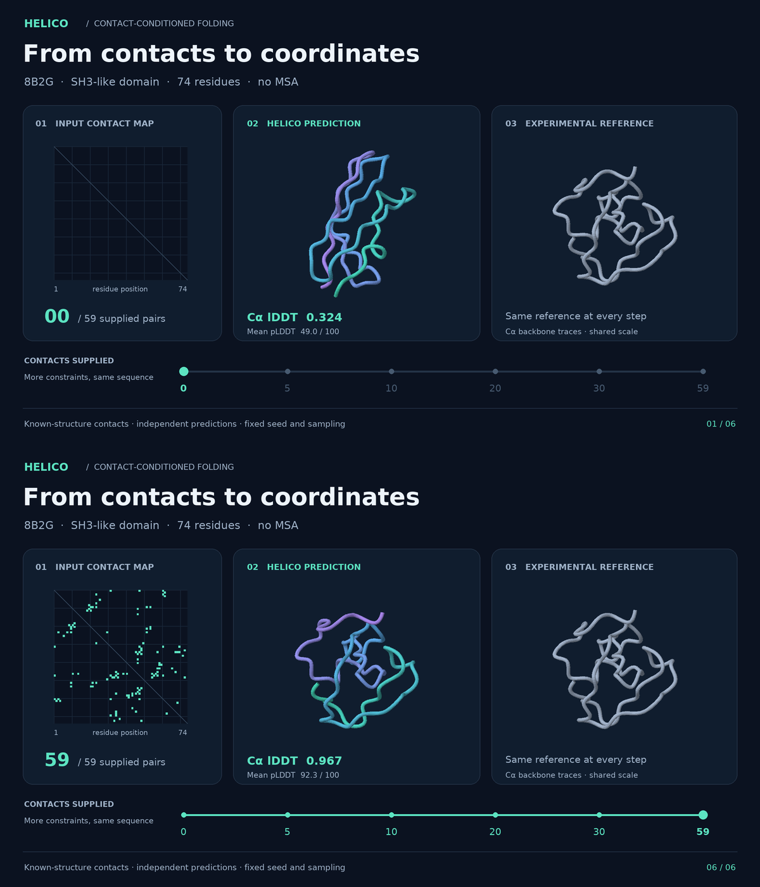

# README contact sweep



The [animated version](../contact_sweep.gif) shows six independent Helico
predictions for the 74-residue SH3-like domain from *Penicillium virgatum*
muramidase, [PDB 8B2G, chain A](https://www.rcsb.org/structure/8B2G).
The model receives only the sequence and the stated contact subset.
The [sequence](sequence.txt) and [ordered contact list](contacts.txt) are ready
to use with the main README's Python and command-line examples.

This target was selected from experiment 14 for its large improvement with
oracle contacts. It illustrates the conditioning behavior, not average
performance or generalization. The contacts come from the deposited structure,
not a contact predictor. The final frame supplies all **positive** contacts;
unlisted pairs remain unknown even in that frame, so this is different from a
complete oracle matrix that also specifies absent contacts.

## Predictions and measurements

| Supplied pairs | Cα lDDT vs reference | Mean pLDDT (0–100) | All-atom prediction |
| ---: | ---: | ---: | --- |
| 0 | 0.324 | 49.0 | [contacts_000.pdb](contacts_000.pdb) |
| 5 | 0.331 | 48.8 | [contacts_005.pdb](contacts_005.pdb) |
| 10 | 0.871 | 86.1 | [contacts_010.pdb](contacts_010.pdb) |
| 20 | 0.952 | 91.0 | [contacts_020.pdb](contacts_020.pdb) |
| 30 | 0.949 | 92.0 | [contacts_030.pdb](contacts_030.pdb) |
| 59 | 0.967 | 92.3 | [contacts_059.pdb](contacts_059.pdb) |

Cα lDDT is computed against the deposited coordinates, with a 15 Å inclusion
cutoff and 0.5 / 1 / 2 / 4 Å error thresholds. It is not the all-atom lDDT used
in the README benchmark table. Mean pLDDT is the model's confidence averaged
over atoms, and requires no reference structure. More contacts need not
improve every intermediate prediction, as the 20- and 30-contact rows show.

## Reproduce

From the repository root, with Helico installed and a CUDA GPU:

```bash
python scripts/readme_contact_sweep.py
```

Then render the saved coordinates on a CPU:

```bash
uv run --no-project --with numpy --with scipy --with pillow \
  python scripts/render_readme_contact_sweep.py
```

The renderer uses DejaVu Sans. Install your platform's DejaVu fonts package,
or set `HELICO_DEMO_FONT_DIR` to the directory containing `DejaVuSans.ttf` and
`DejaVuSans-Bold.ttf`. Rendering writes the GIF, a final-frame
[poster](poster.png), and the static comparison above.

The generation script pins the
[checkpoint revision](https://huggingface.co/timodonnell/helico/tree/52e5a9de1dd1b2333c6a31c687fc29c40521cbf2).
[`data.json`](data.json) records the checkpoint and reference SHA-256 hashes,
source revision, package versions, GPU, exact contact order, raw Cα coordinates,
and scores. The original [reference mmCIF](8b2g.cif) and all six predicted PDBs
are committed alongside it. Results may vary slightly across GPU/software
versions; the committed coordinates reproduce the displayed animation without
running inference again.

Settings:

- `contacts-msafree-01-step6000.pt`, bfloat16, no MSA.
- 10 recycling cycles; 200 diffusion steps; 3 samples per condition, selected
  by the model's own ranking score. Reference accuracy is never used to pick
  a sample.
- Inference seed 0 at every condition. The 59 positive contacts are shuffled
  once with seed 0 and supplied as nested prefixes of 0, 5, 10, 20, 30, and 59.
- Contacts use `pyconfind` 0.6.0 and Helico's `contacts-v1` parameters in
  [`contacts.py`](../../../src/helico/contacts.py).
- Each prediction is rigidly aligned to the reference on corresponding Cα
  atoms. Both structures use the same camera and scale in every frame.
- Tubes follow the Cα traces, colored from the N terminus (green) to the C
  terminus (purple); the reference is gray. These are backbone traces, not
  secondary-structure cartoons. Camera motion is purely for viewing: there
  is no coordinate morphing between predictions or simulation of folding.
